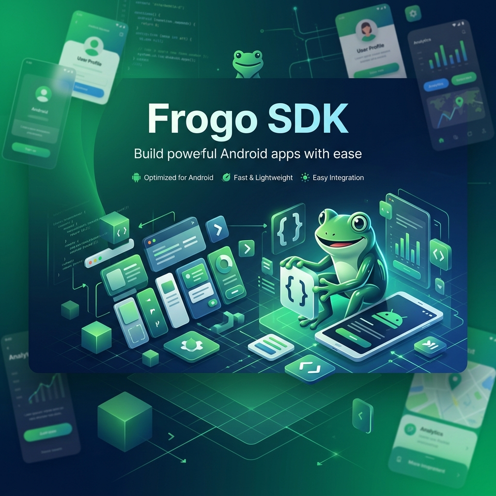
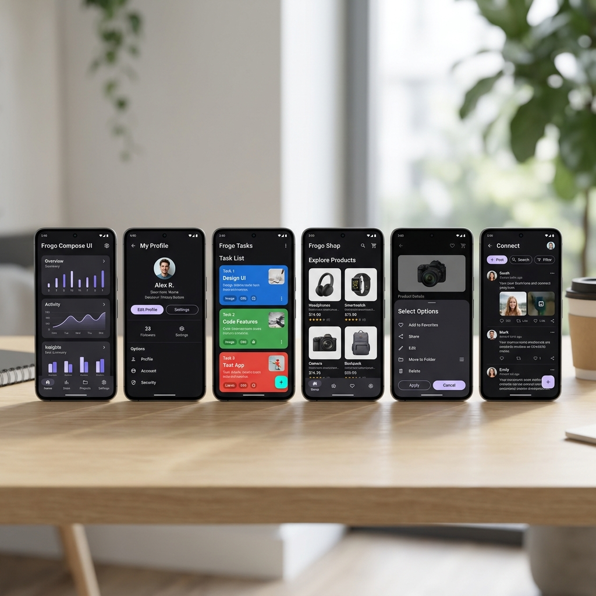

# Frogo SDK 🚀

### The Ultimate Android & Kotlin Development Toolkit



[](https://jitpack.io/#frogobox/frogo-sdk)
[](https://github.com/frogobox/frogo-sdk/actions/workflows/android-ci.yml)
[](https://kotlinlang.org)
[-blue.svg?style=flat-square)](https://developer.android.com)
[](https://developer.android.com/jetpack/compose)
[](https://github.com/frogobox/frogo-sdk/blob/master/LICENSE)
[](http://makeapullrequest.com)

**Frogo SDK** is a production-grade multi-module Android and Kotlin library suite designed to accelerate your development workflow. From stunning Material Design 3 Jetpack Compose UIs to robust architecture (UDF/MVI State ViewModels, Edge-to-Edge activities) and core Kotlin utilities, Frogo SDK delivers the building blocks you need to build scalable, high-quality applications faster.

- 🚀 100% Modern Kotlin architecture with Zero Deprecation Suppression
- 🎨 70+ ready-to-use Jetpack Compose components & Material Design 3 templates
- 🏛️ UDF/MVI State ViewModel architecture for both Compose and ViewBinding
- 🛠️ Pure Kotlin utilities and 16+ core Android extension files
- 🤖 Built-in AI Agent Skill (`frogo-sdk`) for Antigravity, Claude Code, Gemini CLI, Cursor, Copilot, and Codex
- 📄 Privacy Policy: [Click Here](https://github.com/frogobox/frogo-sdk/blob/master/PRIVACY-POLICY.md)
- 📜 License: [Apache 2.0](https://github.com/frogobox/frogo-sdk/blob/master/LICENSE)

---

## 📌 Latest Release

```text
$version_release = 4.0.0
```

### What's New in v4.0.0 (from v3.0.13)

* **Architectural Refocus**: Completely removed all legacy and third-party advertising modules (`frogo-ads-admob`, `frogo-ads-unity`, `frogo-ext-ads`) to make Frogo SDK a pure, lightweight, modular Android & Compose UI/Architecture framework.
* **100% Kotlin Migration**: Converted remaining legacy Java UI widgets and Shimmer components (`FrogoShimmer`, `FrogoShimmerDrawable`, `FrogoShimmerFrameLayout`, etc.) to idiomatic, type-safe Kotlin.
* **Modern Toolchain Upgrade**: Updated Compile SDK & Target SDK to **37 (Android 16)** with **AGP 9.5.1**, **Kotlin 2.4.21**, **KSP 2.3.10**, and **Compose BOM 2026.09.00**.
* **Official AI Agent Skill Integration**: Built-in standardized agent skill (`skills/frogo-sdk`) with automated one-click install scripts for Antigravity, Gemini CLI, Claude Code, Cursor, Copilot, and Codex.
* **Modern Media & Image Loaders**: Standardized Compose UI components on Coil 3 (`io.coil-kt.coil3:coil-compose:3.6.3`) and Glide Compose (`1.0.0-beta10`).
* **Enhanced Test Suite**: Expanded Robolectric 4.18 unit and integration tests across UDF State ViewModels, Compose layouts, and particle animation engines.

---

## 🌟 Key Features

- **🎨 Frogo Compose**: Unified modern Jetpack Compose framework: Edge-to-Edge `FrogoComposeActivity`, UDF/MVI `FrogoComposeStateViewModel`, and 70+ Material 3 widgets, templates, dialogs, bottom sheets, Coil 3 & Glide lists, and fireworks particle canvas.
- **🛠️ Frogo Android**: Unified Android core toolkit & UI kit: ViewBinding Base Activities, Fragments, and BottomSheets, UDF/MVI `FrogoStateViewModel`, 16+ core extensions, Shimmer skeleton framework, PiracyChecker, activity transition animations, and loading indicators.
- **⚡ Frogo Core**: Pure Kotlin cross-platform utilities for strings, dates, math, currency, and data collections.
- **🤖 AI Agent Skill**: Native agent skill package enabling AI assistants to integrate Frogo SDK accurately with zero hallucinations.

---

## 📸 Screenshots & Mockups

### Premium Jetpack Compose Components


*Beautiful, modern, and highly customizable UI components following Material Design 3.*

---

## 📦 Modules Overview

| Module | Namespace | Description | Key Tech Stack / Features |
| :--- | :--- | :--- | :--- |
| `frogo-core` | `com.frogobox.coreutil` | Pure Kotlin Toolkit | Cross-platform utilities, string, date, math, currency, and data transformation |
| `frogo-android` | `com.frogobox.sdk` | Unified Android Core & UI Kit | ViewBinding Base Activities/Fragments, UDF `FrogoStateViewModel`, Shimmer framework, XML animations & indicators, 16+ Extensions |
| `frogo-compose` | `com.frogobox.compose` | Unified Compose Architecture & UI Kit | `FrogoComposeActivity` (Edge-to-Edge, system UI), UDF `FrogoComposeStateViewModel`, 70+ Widgets, Coil 3 & Glide Lists, Fireworks canvas |
| `app` | `com.frogobox.app` | Showcase Application | Comprehensive demo app demonstrating all Frogo SDK components |

---

## 🚀 Quick Start

### Step 1: Add JitPack Repository

In your `settings.gradle.kts`:

```kotlin
dependencyResolutionManagement {
    repositoriesMode.set(RepositoriesMode.FAIL_ON_PROJECT_REPOS)
    repositories {
        google()
        mavenCentral()
        maven("https://jitpack.io")
    }
}
```

### Step 2: Add Dependencies

#### Option A: Gradle Version Catalog (`gradle/libs.versions.toml`) - Recommended

```toml
[versions]
frogoSdk = "4.0.0"

[libraries]
# Full bundle
frogo-sdk = { group = "com.github.frogobox", name = "frogo-sdk", version.ref = "frogoSdk" }

# Or individual modular dependencies
frogo-core = { group = "com.github.frogobox.frogo-sdk", name = "frogo-core", version.ref = "frogoSdk" }
frogo-android = { group = "com.github.frogobox.frogo-sdk", name = "frogo-android", version.ref = "frogoSdk" }
frogo-compose = { group = "com.github.frogobox.frogo-sdk", name = "frogo-compose", version.ref = "frogoSdk" }
```

In your module `build.gradle.kts`:

```kotlin
dependencies {
    implementation(libs.frogo.compose)
    implementation(libs.frogo.android)
    implementation(libs.frogo.core)
}
```

#### Option B: Direct Implementation in `build.gradle.kts`

```kotlin
dependencies {
    // Complete SDK
    implementation("com.github.frogobox:frogo-sdk:4.0.0")

    // Or specific modular dependencies (recommended)
    implementation("com.github.frogobox.frogo-sdk:frogo-compose:4.0.0")
    implementation("com.github.frogobox.frogo-sdk:frogo-android:4.0.0")
    implementation("com.github.frogobox.frogo-sdk:frogo-core:4.0.0")
}
```

---

## 🤖 AI Agent Skill (`frogo-sdk`)

Frogo SDK includes an official **AI Agent Skill** that enables AI coding assistants (**Antigravity**, **Gemini CLI**, **Claude Code**, **Cursor**, **GitHub Copilot**, **Codex**, **Devin**) to accurately understand, generate, and integrate Frogo SDK v4.0.0 APIs with zero obsolete patterns.

### Skill Capabilities
- ✅ **Automated Project Setup**: Configures JitPack, version catalogs, and dependency sets.
- ✅ **Accurate Code Generation**: Writes Material Design 3 Compose components, UDF/MVI ViewModels, and extensions accurately.
- ✅ **Zero Hallucination**: Prevents AI agents from suggesting deprecated APIs or removed modules.
- ✅ **Multi-Platform Support**: Works with all major agent frameworks and IDEs.

### Skill Structure

```text
skills/frogo-sdk/
├── SKILL.md                              # Master instructions for AI Agents
├── references/
│   ├── compose-ui-reference.md           # API for 70+ Jetpack Compose widgets & templates
│   └── core-android-reference.md         # Base classes, UDF ViewModels & 16+ extension files
└── templates/
    ├── libs.versions.toml                # Ready-to-copy version catalog starter
    ├── settings.gradle.kts               # Repository setup template
    └── FrogoComposeActivityTemplate.kt   # Clean Edge-to-Edge Compose Activity starter
```

### Quick Installation

#### Global Installation (Available for All Projects on Machine):

**Windows (PowerShell):**
```powershell
powershell -ExecutionPolicy Bypass -File .\scripts\install-skill.ps1 -Global
```
*(Automatically registers into `~/.gemini/config/skills/frogo-sdk`, `~/.claude/skills/frogo-sdk`, and `~/.agents/skills/frogo-sdk`)*

**Linux / macOS / WSL (Bash):**
```bash
./scripts/install-skill.sh
```

#### Install into a Specific Target Project:

**Windows (PowerShell):**
```powershell
powershell -ExecutionPolicy Bypass -File .\scripts\install-skill.ps1 -TargetProject "D:\AndroidProject\MyAwesomeApp"
```

**Linux / macOS / WSL (Bash):**
```bash
./scripts/install-skill.sh -t /path/to/my-awesome-app
```

### Example AI Agent Prompts

Once the skill is installed, simply prompt your AI coding agent:

#### 🎨 Jetpack Compose UI
> *"Create a dashboard screen using FrogoScaffold with FrogoTopAppBar and FrogoLazyColumn for a list of products."*

The agent will output idiomatic Frogo Compose code:
```kotlin
import androidx.compose.runtime.Composable
import com.frogobox.composeui.template.scaffold.FrogoScaffold
import com.frogobox.composeui.template.appbar.FrogoTopAppBar
import com.frogobox.composeui.list.basic.FrogoLazyColumn
import com.frogobox.composeui.list.basic.FrogoListItem

@Composable
fun ProductDashboardScreen(products: List<ProductItem>) {
    FrogoScaffold(
        topBar = {
            FrogoTopAppBar(title = "Product Catalog")
        }
    ) { paddingValues ->
        FrogoLazyColumn(
            data = products,
            contentPadding = paddingValues
        ) { _, item ->
            FrogoListItem(
                headlineText = item.name,
                supportingText = item.priceFormatted
            )
        }
    }
}
```

#### 🏛️ UDF/MVI State ViewModel & Edge-to-Edge Activity
> *"Create a FrogoComposeActivity with an Edge-to-Edge setup and a FrogoComposeStateViewModel."*

The agent generates standard UDF state management code without manual boilerplate.

### Complete Skill Documentation & References

| Document | Description | Content |
| :--- | :--- | :--- |
| [SKILL.md](skills/frogo-sdk/SKILL.md) | Agent core instructions & architecture | Multi-module guide & agent guardrails |
| [compose-ui-reference.md](skills/frogo-sdk/references/compose-ui-reference.md) | Jetpack Compose UI reference | 70+ widgets, templates, dialogs, lists |
| [core-android-reference.md](skills/frogo-sdk/references/core-android-reference.md) | Core Android & extensions reference | Base classes, ViewModels, 16+ ext files |
| [templates/](skills/frogo-sdk/templates/) | Ready-to-use starter templates | Version catalog, settings & activity starters |

---

## 🤝 Contributing

We welcome contributions! Whether you're fixing a bug, enhancing performance, or suggesting a new Compose widget:

1. Fork the Project
2. Create your Feature Branch (`git checkout -b feature/AmazingFeature`)
3. Commit your Changes (`git commit -m 'feat: Add AmazingFeature'`)
4. Push to the Branch (`git push origin feature/AmazingFeature`)
5. Open a Pull Request

---

## 📄 License & Privacy

- **License**: Distributed under the [Apache 2.0 License](https://github.com/frogobox/frogo-sdk/blob/master/LICENSE).
- **Privacy Policy**: Read our policy [here](https://github.com/frogobox/frogo-sdk/blob/master/PRIVACY-POLICY.md).

---

## 👥 Collaborators

Very open to anyone! I'll write your name under this list. Please contribute by opening an issue or emailing:

- **Email**: [faisalamircs@gmail.com](mailto:faisalamircs@gmail.com)
- **Subject**: `Github *[Github-Username-Account]* [Language] _ [Repository-Name]`
- **Example**: `Github_amirisback_kotlin_frogo-sdk-implementation`

### Contributors
- **Muhammad Faisal Amir** ([@amirisback](https://github.com/amirisback))
- *Waiting for your contribution!*

---

## 📬 Contact & Support

**Muhammad Faisal Amir** - [faisalamircs@gmail.com](mailto:faisalamircs@gmail.com)  
Project Link: [https://github.com/frogobox/frogo-sdk](https://github.com/frogobox/frogo-sdk)

⭐ **Don't forget to star and fork the repository if you find it helpful!**


